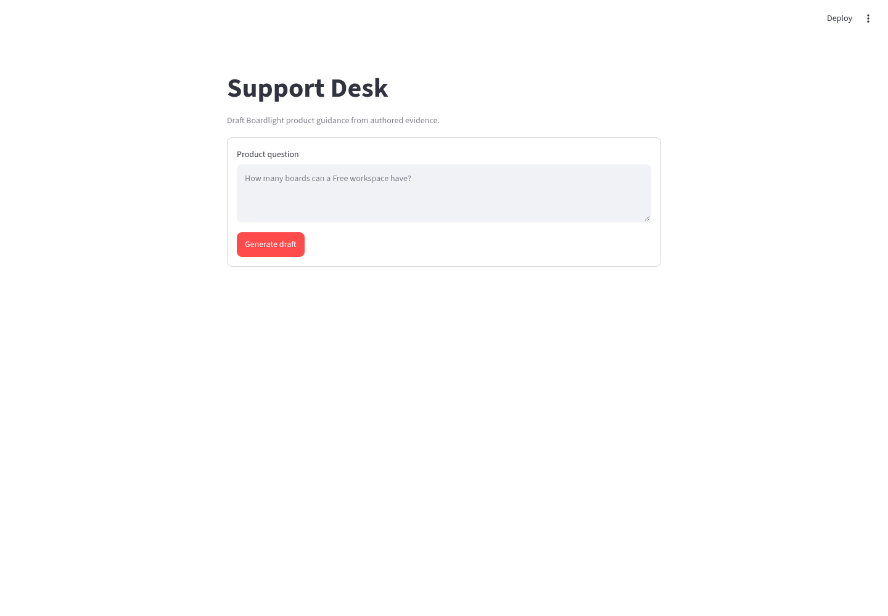
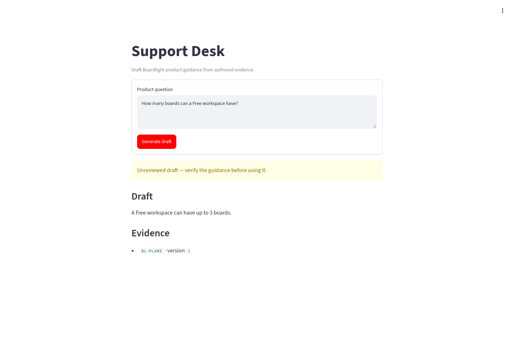
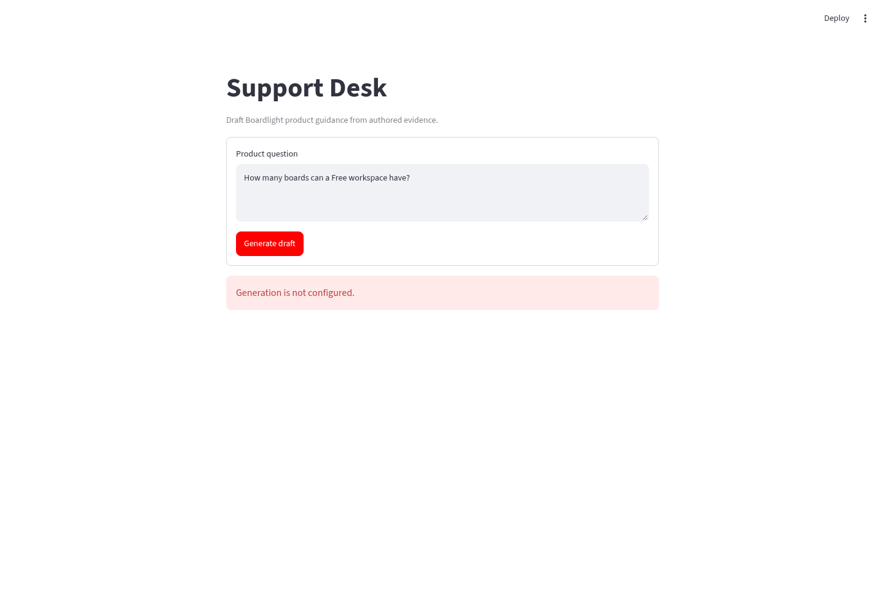

# Stage 1: Coding session reports and summaries

## Slice 1.1

Implementation record (2026-11-08): added the typed question/draft boundaries,
`POST /questions`, a packaged Boardlight v1 lookup, and an OpenAI Agents SDK adapter.
The application admits one generation per process with a 45-second deadline.
Input/body, turn, tool-call, and output-token limits are enforced in code;
provider retries are disabled. Citations must identify evidence actually returned
by the tool. Drafts remain unreviewed; these checks establish source identity,
not semantic grounding. SDK traces are disabled and Responses requests set
`store=False`. See the [local run/configuration path](../../README.md#run-the-local-api)
and [learning conclusion](../learning/slice-1.1.md).

Design revision (2026-11-08): separated health and question routers, kept business
values in the domain and the use-case request in the application layer, and added
HTTP-only health and stable error schemas. Corrected the bounded ASGI request stream,
declared Starlette directly, added an API-owned generic lifespan, and registered the
OpenAI client only for enabled inference. Composition settings are immutable Pydantic
values, direct asynchronous tests use pytest-asyncio, stable agent configuration is
reused, executable limits are centralized, and architecture checks are recursive.
Focused verification was added for these contracts. The final evidence below
supersedes the earlier verification runs.

Final local verification (2026-11-09): the capped Black check completed with all
40 files unchanged. isort, Ruff, strict mypy, lock consistency, OpenAPI generation,
source/wheel builds, `git diff --check`, and 41 deterministic tests passed. The
tests cover API contracts, composition, body-stream replay, domain and application
invariants, generic resource lifecycle, architecture rules, and the actual Agents
SDK loop with synthetic provider responses. The suite passed outside the restricted
sandbox, where its first asynchronous HTTP test stalls.

The current non-root image built as
`sha256:682a945b758c550e055e97c9bc365393c1b9b29805a7b3935c0e6878e965bad2`.
Its Docker health check, liveness endpoint, unconfigured readiness and question
responses, runtime UID 10001, packaged evidence, and paid-smoke module passed a
local smoke check. The wheel contains both route modules, the smoke runner, and all
four evidence documents.

Follow-up local verification (2026-11-09): after adding sanitized provider usage
diagnostics and the fixed paid-smoke runner, 43 deterministic tests, isort, Ruff,
strict mypy, and `git diff --check` passed. Black reformatted the two new modules
but exited at the mandatory 30-second cap, so it was not retried and remains
incomplete for that invocation. The user subsequently completed Black manually and
reported that it fixed one formatting issue. Lock consistency, OpenAPI generation,
source/wheel builds, and the rebuilt container smoke also passed.

The approved paid smoke used
`gpt-5.4-mini-2026-03-17` for exactly two authored questions: Free board capacity
(expect `BL-PLANS` v1) and refund policy (expect insufficient evidence).
The total experiment budget was USD 0.25; at most six model calls and 6,144
output tokens across both attempts, with no automatic retries. Stop after the two
attempts, including failures; further attempts need a new agreed budget. This is
an experiment budget, not an account-level spending control. The
[official model page](https://developers.openai.com/api/docs/models/gpt-5.4-mini)
lists Responses, function calling, and structured outputs, with standard input/
output prices of USD 0.75/4.50 per million tokens as checked on 2026-11-08.
Only authored questions and product evidence go to OpenAI; SDK tracing stays off.

Smoke execution (2026-11-09): `.env.smoke` passed existence, mode-`600`, and Git
ignore checks without its contents being read. The board-capacity attempt failed
with `APIConnectionError` and was not retried. Separate unauthenticated curl and
synthetic-key SDK checks then confirmed general OpenAI connectivity. The remaining
refund-policy attempt completed far enough to build live provider/tool diagnostics,
then failed a runner postcondition with `RuntimeError`. The runner emitted results
only after postconditions, so its draft, response IDs, usage, and cost were lost.
No secret appeared in output, and no further paid attempt was made.

The runner now flushes each sanitized case record before validating postconditions
and supports selecting one remaining authored case without retrying earlier work.
A regression test verifies that a completed case remains recoverable when a
postcondition fails.

Paid follow-up (2026-11-09): the approved USD 0.10 experiment ran each authored
case once with no retries. Both used one lookup and two model calls. Board capacity
returned `answered`, cited and read only `BL-PLANS`, and passed human review and all
postconditions. It used 1,801 input and 74 output tokens in 7.983 seconds, for an
estimated USD 0.00168375.

Refund policy returned `insufficient_evidence`, invented no eligibility or refund
rule, and appropriately requested authoritative clarification. It read and cited
`BL-PLANS` and `BL-UPGRADES`, rather than the authored expectation of no evidence,
so the strict postcondition failed. Human review accepts the safe evidence-gap
answer but records a semantic citation limitation: those sources show what the
agent inspected but do not prove that no refund policy exists. It used 2,158 input
and 169 output tokens in 3.872 seconds, for an estimated USD 0.00237900.

The follow-up totaled four model calls, 3,959 input tokens, no cached input, 243
output tokens, no reported reasoning tokens, and estimated cost USD 0.00406275.
SDK tracing remained disabled, Responses storage was false, and no credential
appeared in output. Live SDK/tool compatibility, bounded execution, structural
grounding, usage capture, and safe insufficient-evidence behavior are verified.
The semantic citation mismatch becomes a baseline case for Slice 1.8 rather than
being hidden or treated as proof of grounding quality. Slice 1.1 is complete.

## Slice 1.2

### Implementation

Implementation record (2026-11-09): added a Streamlit question form, draft and
evidence display, explicit unreviewed labeling, and safe empty-input, API, transport,
and invalid-contract failures. A typed HTTP client validates requests and parses
FastAPI results into the existing domain draft. The UI imports no repository or
agent adapter. Locked Streamlit and HTTPX runtime dependencies and two-service local
Compose orchestration provide API startup ordering and health checks.

### Deterministic and static verification

Streamlit AppTest followed the authored Free-board question through the form and
verified the draft and `BL-PLANS` evidence display. Client tests covered valid
results, declared API errors, transport failure, and invalid response payloads. All
55 deterministic tests passed outside the restricted sandbox, where the existing
asynchronous HTTP test stalls. isort, Ruff, strict mypy, lock consistency, Compose
configuration, source/wheel builds, relative-link verification, and
`git diff --check` passed.

Final formatting verification (2026-11-09): the required capped command completed
within 30 seconds and reported all 50 files unchanged:

```text
timeout 30s env UV_CACHE_DIR=<writable-cache> uv run black --check src tests
All done! ✨ 🍰 ✨
50 files would be left unchanged.
```

### Compose and browser verification

The networked Compose build completed from the locked dependency set. Compose waited
for the API health check before starting Streamlit. Both containers became healthy,
ran as the image's non-root `app` user, and exposed only localhost ports. The verified
image identities were:

- API: `sha256:204da36d9ca8e02113152893666127a3cef7492428b2f9639912b79e8b15b4c1`
- UI: `sha256:400c8d41944958ffd7b2367da0883dc896a1285fd0a29890c784e16754233851`

`GET /health/live` returned `{"status":"alive"}`, and Streamlit's health endpoint
returned `ok`. With inference explicitly disabled, the authored question returned
HTTP 503 with the declared `generation_unavailable` code and safe message. A real
headless Chromium session submitted the same question through the Compose-served UI
and displayed that safe message.

Browser review also used a temporary deterministic API adapter to verify the success
display without another paid model call. It returned the authored Free-workspace
capacity guidance with `BL-PLANS` v1, and the UI displayed the unreviewed warning,
draft, and evidence identity. The adapter and browser helper were temporary
verification tools and are not product dependencies.

Initial question form:



Successful deterministic draft and evidence:



Safe response from the inference-disabled Compose API:



No model call was made and no additional inference cost was incurred during Slice
1.2 verification.

### Learning conclusion

The typed HTTP boundary lets Streamlit distinguish safe application failures from
transport and contract failures without depending on repositories or agent internals.
Deterministic tests establish boundary behavior; the Compose and browser checks add
evidence for packaging, startup ordering, service connectivity, and operator-visible
behavior. See the [learning record](../learning/slice-1.2.md). Slice 1.2 is complete.

## Slice 1.3

Decisions recorded on 2026-11-11: use the existing AWS Organizations management
account in `us-east-1` as a bounded learning-environment exception, Terraform with
remote S3 state, GitHub OIDC, Cognito hosted login with Google and an explicit operator
group, and a default CloudFront HTTPS URL backed by a VPC origin, internal Application
Load Balancer, and one ECS/Fargate service. Reserve private database subnets for later
private RDS PostgreSQL. Treat USD 10 as a temporary deployment-experiment budget, not
an enforced service limit. The user completed the account budget alert, installed
Terraform 1.17.1, and verified temporary caller identity through the
`support-desk-bootstrap` Identity Center profile. No workload resources have been
provisioned. See [ADR 0001](../decisions/0001-manage-aws-infrastructure-with-terraform.md),
[ADR 0002](../decisions/0002-use-cognito-with-google-for-operator-access.md), and
[ADR 0003](../decisions/0003-use-a-cloudfront-vpc-origin-for-domain-free-https.md),
and [ADR 0004](../decisions/0004-use-the-existing-management-account-for-the-learning-deployment.md).

Implement Slice 1.3 in these review units:

1. Bootstrap encrypted, versioned, locked Terraform state and the restricted GitHub
   OIDC roles.
2. Add application authorization and deterministic authorized/unauthorized tests.
3. Add reviewable networking, ECR, ECS, load-balancing, CloudFront, Cognito, secret,
   health-check, and future database-subnet infrastructure.
4. Add immutable image build/deployment, smoke, rollback, and teardown workflows and
   guidance.
5. After explicit live-execution approval, provision, configure Google federation,
   deploy, verify, roll back, and tear down within the agreed budget.

### Bootstrap preparation

Local preparation on 2026-11-11 added the account-guarded Terraform bootstrap for
the encrypted, versioned, non-public S3 state bucket and repository-scoped GitHub
OIDC roles. The roles initially have state-only permissions; service permissions
wait for the concrete infrastructure review. The first apply will use local state,
then migrate it to the created S3 backend before application infrastructure begins.
Separate protected GitHub environments gate state-reading plans and infrastructure
applies so untrusted pull-request code cannot obtain state credentials.

Terraform formatting and validation passed with Terraform 1.17.1 and locked AWS
provider 6.72.0. Two mocked Terraform tests passed, covering bounded resource names,
state retention, versioning, GitHub role names, and reuse of an existing account-level
GitHub provider. Provider download required network access; validation and tests made
no AWS API calls. An authenticated saved plan proposed the expected 11 additions with
no changes or deletions. The ignored inputs and plan are owner-readable only. No
apply ran, and no AWS resources or costs were created.
